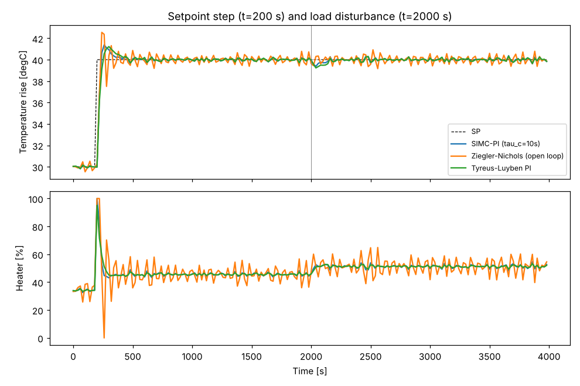

# thermal-pid-lab

A small, dependency-light lab for the full PID workflow on a temperature loop:
**identify → tune → simulate → benchmark**, the same sequence used when commissioning
a temperature loop on a real plant.

The demo runs on a **published, experimentally identified model** of a laboratory
thermal process, not on invented numbers (see [Source](#source)). A generic
continuous first-order-plus-dead-time (FOPDT) model is also included for
experimenting.

## What it does

| Step | Method | Module |
|---|---|---|
| Process models | Published discrete models of two laboratory thermal systems, plus a generic FOPDT model with dead time, measurement noise and load disturbance | `published.py`, `plant.py` |
| Controller | ISA PID, derivative on PV with filter `Tf = max(Td/N, 2·dt)`, setpoint weighting, back-calculation anti-windup, bumpless manual→auto | `pid.py` |
| Identification | Open-loop step test, Smith two-point method (28.3 % / 63.2 %) | `tuning.py` |
| Autotuning | Åström–Hägglund relay test with hysteresis correction → Ku, Pu | `tuning.py` |
| Tuning rules | SIMC, IMC-PI, Ziegler–Nichols (open loop and ultimate), Tyreus–Luyben, with the zero-order-hold correction (Ts/2) for sampled loops | `tuning.py` |
| KPIs | IAE, ISE, overshoot, rise time, settling time, controller total variation | `metrics.py` |

## Quick start

```bash
pip install -e ".[dev]"
pytest -q
python -m thermal_pid_lab.demo --out docs
```

## Results (from `docs/report.json`)

Plant: heater 1 → temperature 1 of the Temperature Control Lab (TCLab), published
first-order model K = 0.878 °C/%, pole 0.886 at Ts = 20 s (τ ≈ 165 s). The loop
runs at the model's own sample time. Setpoint step +30 → +40 °C (temperature rise
above the starting point) at t = 200 s, then a load disturbance at t = 2000 s.
Measurement noise (σ = 0.1 °C) is added for the demo; it is not part of the
published model.



| Rule | Kc | Ti [s] | Td [s] | IAE | Overshoot [%] | Settling [s] | Total variation of u |
|---|---|---|---|---|---|---|---|
| SIMC-PI | 9.41 | 80.6 | 0 | 545 | 13.8 | 140 | 172 |
| Ziegler–Nichols PID | 22.59 | 20.2 | 5.0 | 954 | 25.5 | not settled | 878 |
| Tyreus–Luyben PI | 6.08 | 88.0 | 0 | 571 | 12.2 | 180 | 112 |

Settling is measured with a ±5 % band (±0.5 °C), above the noise level, and only
counts if the response then stays in the band for at least 10 % of the window;
metrics cover t = 200–2000 s. Each sample is recorded before the controller acts on it.

**Takeaways**

- **The step test finds no dead time.** The published model has only the
  one-sample delay of a sampled first-order process, so the identified θ is ≈ 0
  and the classic rules break down: Ziegler–Nichols, and SIMC with its default
  τc = θ, are undefined at θ = 0. The demo adds the usual zero-order-hold
  correction, an apparent dead time of Ts/2 = 10 s, before tuning.
- **Ziegler–Nichols is too aggressive for a 20 s loop.** Its Kc = 22.6 is above
  the P-only ultimate gain of the discrete loop (≈ 18.8). The PID loop is still
  stable, but its gain margin is only about 1.4 (found by raising Kc until the
  noise-free loop oscillates). Without noise it settles; with
  σ = 0.1 °C noise the temperature swings by about ±0.8 °C and keeps leaving the
  band, so it never counts as settled. It also has the worst IAE, 25 % overshoot, and an output that moves
  about 8× more than with Tyreus–Luyben. SIMC gives the best IAE and the
  fastest settling, and Tyreus–Luyben gives the calmest output.
- **The relay test needs care in sampled loops.** The relay oscillates at the
  Nyquist frequency (Pu = 2·Ts = 40 s). There the plant does not filter the
  relay's square wave, so the describing-function estimate of Ku is high by a
  factor 4/π compared with the exact discrete ultimate gain ((1 + p)/(K(1 − p))
  ≈ 18.8); the noise-free relay test gives about 24. A unit test checks both
  values. The demo's 19.4 only looks closer to the exact value: measurement
  noise inflates the oscillation amplitude, which pulls the estimate down.

Identification and relay plots: [`01_step_identification.png`](docs/01_step_identification.png),
[`02_relay_autotune.png`](docs/02_relay_autotune.png).

## Source

The models in `published.py` are the first-order discrete transfer functions
identified with the output-error method from sequential step tests, the option
the paper recommends. Poles are from Tables 3 and 9, gains from Tables 5 and 11.

> Rivero-Contreras, R., Zamarreño, J. M., Tadeo, F. (2022). *Modelado experimental
> de dos sistemas de laboratorio multivariables*. XLIII Jornadas de Automática:
> libro de actas, pp. 599–606. https://doi.org/10.17979/spudc.9788497498418.0599
> (open access, CC BY-NC-SA 4.0).

Two systems are available:

- **TCLab**: two heaters and two temperature sensors, a 2×2 coupled system, Ts = 20 s.
- **Temperature conditioning system**: a blower-heater and an ambient-air fan
  mixed downstream, with three temperature sensors, Ts = 60 s.

The paper identifies the models around an operating point it does not report.
The demo treats the TCLab model as valid from 0 % power upwards, which is an
assumption made for the simulation.

## Design notes

- Derivative acts on the measurement, so setpoint changes produce no derivative kick.
- Anti-windup uses back-calculation with tracking time `Tt = sqrt(Ti·Td)`, or `Ti` for PI.
- The demo uses a fixed random seed, so results are reproducible.

## License

Code: MIT. The model coefficients are cited from the paper above.
